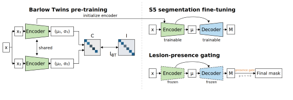
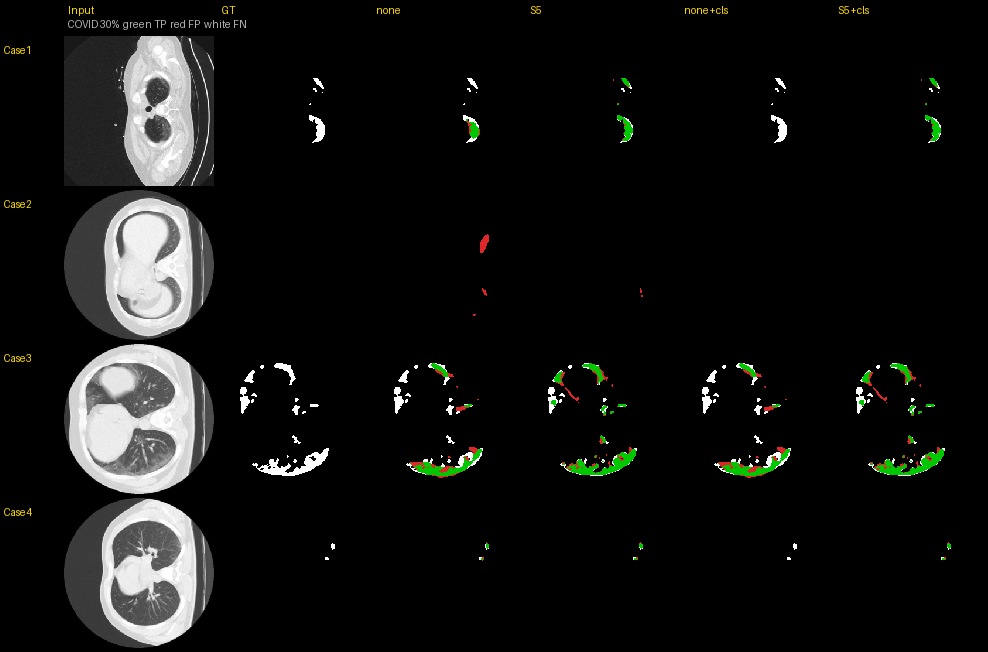
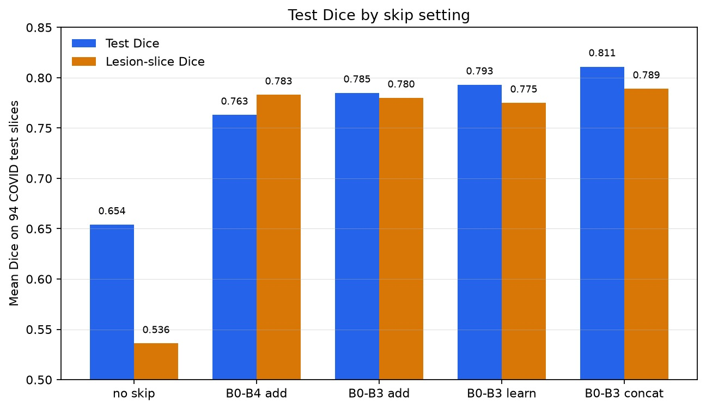
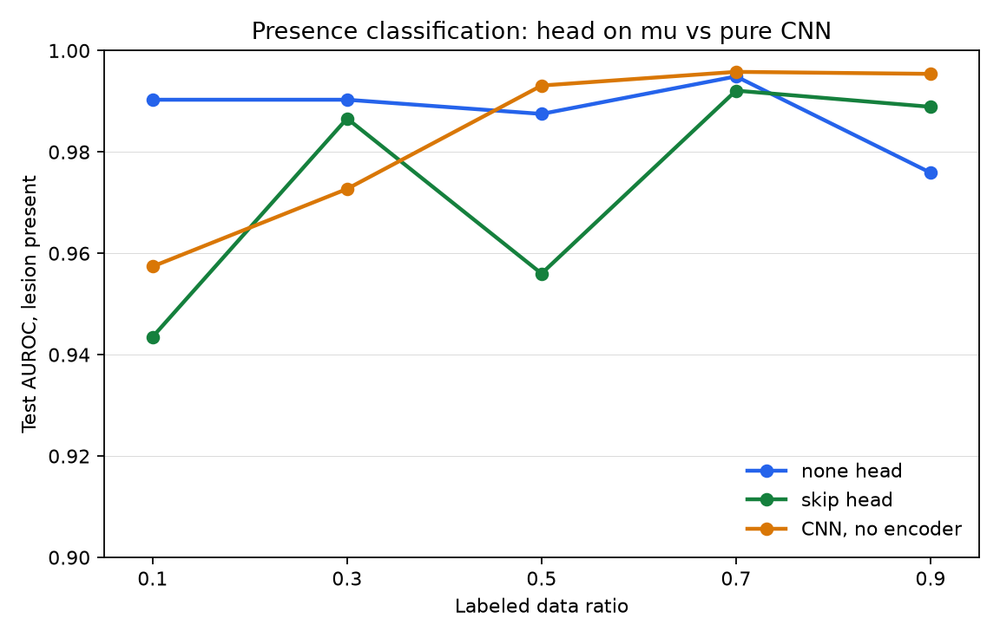

This document was drafted in Cursor and will be revised later.  
이 문서는 Cursor로 작성했으며, 이후 수정할 예정입니다.

# BT-VAE-Based Medical Image Segmentation with Skip Connections and Lesion-Presence Classification

**스킵 연결과 분류를 결합한 BT-VAE 기반 제한된 레이블 환경의 의료영상 분할**

Figures live under [`results/`](results/). Pipeline walkthrough: [Main.ipynb](Main.ipynb).

---

## English

### Why this code exists

Expert pixel labels are expensive, so medical segmentation often runs with **few labeled slices**. BT-VAE already helps by pre-training an encoder (Barlow Twins) then decoding masks from the latent mean μ.

Still missing in practice:

1. **Spatial detail** — μ alone blurs small lesions and boundaries.  
2. **Empty-slice false positives** — skips restore detail but can paint lesions where none exist.

This repo adds **skip connections** (better shape) and a **lesion-presence head** (clear the whole mask when the slice looks empty). Skips reconstruct; gating only suppresses false alarms.

| Need | Use |
|---|---|
| Cover lesions with scarce labels | Skip BT-VAE (`S5`, B0–B3 concat) |
| Kill empty-slice false masks | Presence head + τ from validation |
| Both | Skip BT-VAE+CLS (`S5+cls`: draw, then gate) |

### Method (Fig. 1)



Barlow Twins pre-train → Skip (or none) segmentation → freeze segmenter → train Head(μ) → at test, drop mask if presence probability &lt; τ.

| Paper | Code | Meaning |
|---|---|---|
| BT-VAE | `none` | Decode from μ only |
| Skip BT-VAE | `S5` | + B0–B3 concat skips (B4 off) |
| BT-VAE+CLS | `none+cls` | none mask + gate |
| Skip BT-VAE+CLS | `S5+cls` | S5 mask + gate |

---

### Exp. 1 — Label ratio (COVID)

Train set thinned to 10–90% (patient-level); val/test fixed (94 test slices, 40 empty).


**Takeaway:** Skip BT-VAE+CLS leads overall Dice at every ratio. Gains are largest when labels are scarce (e.g. 10%: BT-VAE 0.505 → Skip+CLS 0.768). At **30%** (paper operating point):

| | Overall Dice | Empty-slice FP |
|---|---:|---:|
| Skip BT-VAE | 0.745 | 0.225 |
| Skip BT-VAE+CLS | **0.801** | **0.05** |

+0.056 Dice (~7.5% relative); empty FP down ~77.8% relative.

**Qualitative (COVID 30%, Fig. 5 style)** — green TP, red FP, white miss:



- Lesion cases: `S5` covers more than `none`; `none+cls` can wipe a true lesion; `S5+cls` usually keeps it.  
- Empty case: raw models paint red FP; CLS clears the slice.  
- Gating does **not** fix boundaries inside a kept slice — it only keeps or drops the whole mask.

---

### Exp. 2 — Skip ablation (full COVID train)

Which skips and how to fuse them?



**Takeaway:** B0–B3 **concat** wins (test Dice ≈ 0.811). Adding B4 or using add/learn fusion is worse. That setting is the Skip BT-VAE used everywhere else.

---

### Exp. 3 — Presence head vs CNN

Does Head(μ) discriminate presence without a second encoder?



**Takeaway:** Skip-head AUROC stays ≥ ~0.94 at all ratios; at 30% it beats a from-scratch CNN (~0.987 vs ~0.973). The head is kept for **mask gating**, not as a standalone classifier contest winner.

---

### Exp. 4 — BP ultrasound (30%)

Same four models, different modality (brachial plexus).


**Takeaway:** Skips recover more of the target on lesion slices; only `S5+cls` reliably blanks the empty false-positive case. Same draw-then-gate recipe transfers beyond COVID CT.

---

### Caveat (gating)

Slice-level gate: a true lesion below τ loses the **entire** mask. COVID 30% before → after: FP 9→2, FN 4→6. Choose τ with that trade-off in mind.

### Run

```bash
python -m pipeline segment --modes none,s5
python -m pipeline classify
python -m pipeline figures
```

---

## 한글

### 왜 이 코드가 있는가

픽셀 레이블이 비싸 의료 분할은 **라벨이 부족한** 경우가 많다. BT-VAE는 Barlow Twins로 인코더를 사전학습한 뒤 μ로 마스크를 복원한다.

남는 문제:

1. **공간 정보** — μ만으로는 작은 병변·경계가 흐려진다.  
2. **빈 슬라이스 오검출** — 스킵은 디테일을 살리나, 병변 없는 슬라이스에도 마스크를 그릴 수 있다.

이 저장소는 **스킵**으로 형태를 살리고, **병변 존재 헤드**로 “없을 것 같은” 슬라이스 마스크를 통째로 지운다.

| 목적 | 사용 |
|---|---|
| 라벨이 적을 때 병변을 더 잘 덮기 | Skip BT-VAE (`S5`) |
| 빈 슬라이스 가짜 마스크 줄이기 | 존재 헤드 + 검증 τ |
| 둘 다 | `S5+cls` (그린 뒤 게이트) |

### 방법 (그림 1)


사전학습 → 스킵(또는 none) 분할 → 분할기 고정 → Head(μ) 학습 → 존재 확률 &lt; τ이면 마스크 제거. 모델 대응표는 영문과 동일 (`none` / `S5` / `+cls`).

---

### 실험 1 — 레이블 비율 (COVID)

학습만 10–90%로 줄이고 검증·테스트는 고정.


**요약:** 모든 비율에서 Skip+CLS가 전체 Dice 최고. 라벨이 적을수록 이득이 큼. **30%**에서 Skip 0.745 → Skip+CLS **0.801**, 빈 슬라이스 오검출 0.225 → **0.05**.

**정성 (COVID 30%):**


병변 케이스에서는 스킵이 더 넓게 덮고, `none+cls`는 병변까지 지울 수 있으며 `S5+cls`는 대체로 유지한다. 빈 케이스에서는 CLS가 빨간 FP를 지운다. 게이팅은 경계 보정이 아니라 **슬라이스 단위 유지/삭제**다.

---

### 실험 2 — 스킵 소거


**요약:** B0–B3 **concat**이 최고 → Skip BT-VAE로 채택.

---

### 실험 3 — 존재 헤드 vs CNN


**요약:** Skip 헤드는 전 비율 AUROC 약 0.94 이상. 30%에서는 독립 CNN보다 높음. 목적은 분류 대회가 아니라 **마스크 게이팅**.

---

### 실험 4 — BP 초음파 (30%)


**요약:** 병변 슬라이스에서는 스킵이 형태를 더 살리고, 빈 슬라이스에서는 `S5+cls`만 안정적으로 FP를 제거. COVID와 같은 draw-then-gate가 초음파에도 적용된다.

---

### 주의

게이팅은 슬라이스 단위라, 병변 슬라이스가 τ 미만이면 마스크 **전체**가 사라진다(FN 증가). COVID 30%: FP 9→2, FN 4→6.

### 실행

```bash
python -m pipeline segment --modes none,s5
python -m pipeline classify
python -m pipeline figures
```

세부 구조는 [Main.ipynb](Main.ipynb).
