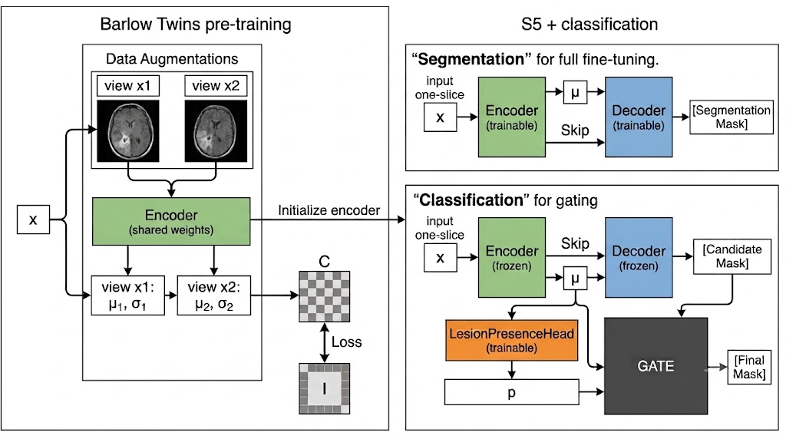
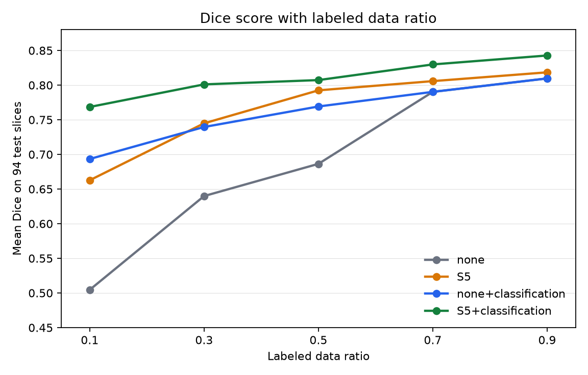
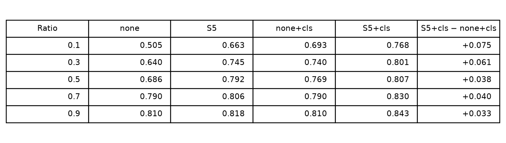
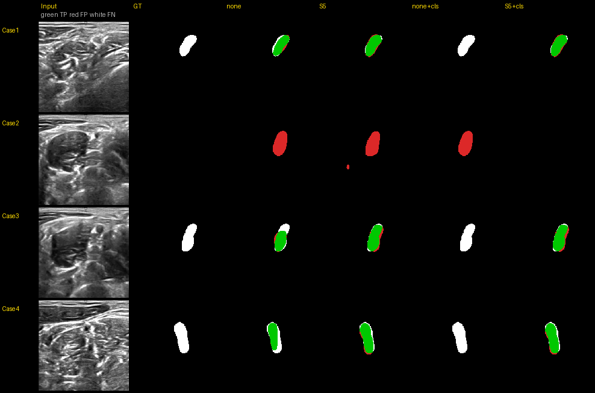
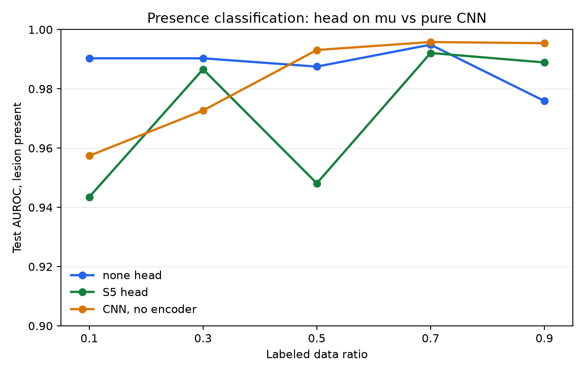

Scroll down for the English version.

이 문서는 Cursor로 작성했으며, 이후 수정할 예정입니다.

This document was drafted in Cursor and will be revised later.

# S5와 병변 존재 분류

제한된 라벨로 COVID CT 병변을 나누는 실험이다. 인코더, S5 디코더, 병변 존재 헤드가 어떻게 이어지는지는 [Main.ipynb](Main.ipynb)에 있다. 인코더는 Barlow Twins로 미리 학습한 뒤, 분할 단계에서 디코더와 함께 미세조정한다. 비교하는 모델은 네 개다.

| 모델 | 분할 | 병변 존재 헤드 |
|---|---|---|
| none | 디코더는 잠재 평균 μ만 받는다. | 없음 |
| S5 | 같은 인코더에 해상도 B0–B3의 concat skip을 붙인다. B4는 끈다. | 없음 |
| none+classification | none이 그린 마스크 | μ에서 P(병변 존재) |
| S5+classification | S5가 그린 마스크 | μ에서 P(병변 존재) |

Skip은 병변의 위치와 경계를 μ라는 병목을 거치지 않고 디코더로 넘긴다. 그래서 S5는 none보다 병변 모양을 더 많이 덮는다. 밖으로 번진 픽셀이 있어도, 실제 병변과의 겹침이 커서 병변 슬라이스의 Dice가 높다.

분류는 그리기 다음에 온다. 분할기를 고정하고 μ 위에 헤드만 학습한다. 헤드는 로짓 하나를 내고, 확률은 그 로짓의 시그모이드이다.

```
p = sigmoid(Head(μ)) = P(병변 존재 | 슬라이스)
```

검증에서 전체 Dice가 최대인 임계값 τ를 고른다. 테스트에서 p가 τ보다 낮으면 그 슬라이스의 마스크를 통째로 비운다. 헤드는 경계를 다시 그리지 않는다. 병변이 없는 슬라이스의 오검출을 지울 뿐이다. 병변이 있는 슬라이스 안에서 밖으로 번진 픽셀은 그대로 남는다.

## 데이터

COVID CT는 학습 743장, 검증 92장, 테스트 94장이다. 테스트 94장 중 40장은 병변이 없는 슬라이스다.

라벨 비율 0.1, 0.3, 0.5, 0.7, 0.9는 학습 집합만 환자 단위로 줄인 비율이다. 검증과 테스트는 모든 비율에서 같다.

| 비율 | 학습 슬라이스 |
|---:|---:|
| 0.1 | 74 |
| 0.3 | 223 |
| 0.5 | 372 |
| 0.7 | 520 |
| 0.9 | 669 |

정성 비교는 다른 뇌 영상 집합의 30% 분할에서 고른 테스트 슬라이스로 본다.

## 학습

분할 손실은 Dice와 BCE를 같은 비율로 섞고 0.99를 곱한 뒤, KL 0.01을 더한다. 최적화는 AdamW, 학습률 1e-4, 배치 4이다. 검증 손실이 40 에폭 동안 줄지 않으면 멈추고, 검증 손실이 가장 낮은 가중치를 쓴다. 디코더의 입력은 샘플 z가 아니라 μ로 고정한다.

분류 손실은 `BCEWithLogits`이고 양성 가중치는 2이다. 시그모이드는 손실 안에서 적용된다.

## 결과

COVID 테스트 94장의 평균 Dice이다. 가로축은 학습에 쓴 라벨 비율이다.





라벨 30%가 데이터가 부족한 의료 영상의 기준점이다. 이 비율에서 S5는 none보다 병변을 더 잘 덮고, 빈 슬라이스 오검출도 더 적다.

| | 전체 Dice | 병변 슬라이스 Dice | 빈 슬라이스 오검출 |
|---|---:|---:|---:|
| none | 0.640 | 0.595 | 0.30 |
| S5 | 0.745 | 0.723 | 0.23 |
| S5+classification | 0.801 | 0.691 | 0.05 |

분류를 붙이면 빈 슬라이스 오검출이 0.23에서 0.05로 줄고, 전체 Dice는 0.745에서 0.801로 오른다. 병변 슬라이스 Dice가 0.723에서 0.691로 조금 내리는 것은, 존재 확률이 τ보다 낮은 병변 슬라이스 일부를 헤드가 통째로 지우기 때문이다.

라벨 30% 테스트 94장을 슬라이스 단위로 센 혼동 행렬이다. 행은 정답, 열은 S5+classification이 τ=0.58에서 남긴 예측이다.

|  | 병변으로 예측 | 빈 슬라이스로 예측 |
|---|---:|---:|
| 병변 슬라이스 54장 | TP 48 | FN 6 |
| 빈 슬라이스 40장 | FP 2 | TN 38 |

게이트 전에는 TP 50, FN 4, FP 9, TN 31이었다. 게이트가 FP를 9에서 2로 줄이는 대신 FN은 4에서 6으로 늘었다. 이후에는 이 FP와 FN의 간극을 조절해 FN을 최대한 줄일 계획이다.

다른 뇌 영상 30% 테스트의 네 장이다. 초록은 맞은 병변, 빨강은 오검출, 흰색은 놓친 병변이다.



## CNN으로 분류하는 편이 더 낫지 않은가?

병변 유무만 본다면, 같은 풀링 헤드를 단 CNN이 인코더 없이 더 단순해 보인다. 아래는 같은 COVID 테스트에서 병변 존재 AUROC이다. 파랑과 초록은 인코더의 μ에 올린 헤드이고, 주황은 인코더가 없는 CNN이다.



학습 데이터를 30%만 썼을 때, 인코더를 달아 둔 쪽이 CNN보다 높았다. 테스트 AUROC는 none 헤드 0.990, S5 헤드 0.987, CNN 0.973이다. 나머지 비율에서도 세 곡선의 차이는 크지 않다.

---

# S5 and lesion-presence classification

This document was drafted in Cursor and will be revised later.

This experiment segments COVID CT lesions with limited labels. How the encoder, the S5 decoder, and the lesion-presence head connect is in [Main.ipynb](Main.ipynb). The encoder is first trained with Barlow Twins, then fine-tuned together with the decoder during segmentation. Four models are compared.

| Model | Segmentation | Lesion-presence head |
|---|---|---|
| none | The decoder receives only the latent mean μ. | None |
| S5 | The same encoder, with concat skips at resolutions B0–B3. B4 is off. | None |
| none+classification | The mask drawn by none | P(lesion present) from μ |
| S5+classification | The mask drawn by S5 | P(lesion present) from μ |

Skips carry lesion location and boundaries to the decoder without passing them through the μ bottleneck. S5 therefore covers the lesion shape more completely than none. Extra pixels outside the lesion still leave a higher Dice on lesion slices, because the overlap with the true lesion is larger.

Classification comes after drawing. The segmenter is frozen and only a head on μ is trained. The head emits one logit, and the probability is the sigmoid of that logit.

```
p = sigmoid(Head(μ)) = P(lesion present | slice)
```

τ is the threshold that maximizes overall Dice on the validation set. On the test set, the mask of a slice is cleared entirely when p is below τ. The head does not redraw boundaries. It only removes false positives on slices that contain no lesion. Pixels that spill outside a lesion, on a slice that does contain one, stay in the mask.

## Data

The COVID CT set has 743 training slices, 92 validation slices, and 94 test slices. Forty of the 94 test slices contain no lesion.

Label ratios 0.1, 0.3, 0.5, 0.7, and 0.9 thin only the training set, at the patient level. Validation and test stay the same at every ratio.

| Ratio | Training slices |
|---:|---:|
| 0.1 | 74 |
| 0.3 | 223 |
| 0.5 | 372 |
| 0.7 | 520 |
| 0.9 | 669 |

Qualitative comparison uses test slices from a 30% split of a separate brain-image set.

## Training

The segmentation loss mixes Dice and BCE in equal parts, multiplies that mix by 0.99, and adds KL with weight 0.01. The optimizer is AdamW with learning rate 1e-4 and batch size 4. Training stops when the validation loss does not fall for 40 epochs, and the weights with the lowest validation loss are kept. The decoder is conditioned on μ, not on a sampled z.

The classification loss is `BCEWithLogits` with a positive weight of 2. The sigmoid is applied inside the loss.

## Results

Mean Dice on the 94 COVID test slices. The horizontal axis is the labeled-data ratio used for training.


The 30% label ratio is the operating point for scarce medical labels. At this ratio, S5 covers lesions better than none and also produces fewer false positives on empty slices.

| | Overall Dice | Lesion-slice Dice | Empty-slice false positives |
|---|---:|---:|---:|
| none | 0.640 | 0.595 | 0.30 |
| S5 | 0.745 | 0.723 | 0.23 |
| S5+classification | 0.801 | 0.691 | 0.05 |

Adding classification lowers the empty-slice false-positive rate from 0.23 to 0.05 and raises overall Dice from 0.745 to 0.801. Lesion-slice Dice falls slightly, from 0.723 to 0.691, because the head clears a few lesion slices whose presence probability is below τ.

Slice-level confusion matrix on the 94 test slices at the 30% label ratio. Rows are the ground truth. Columns are what S5+classification keeps at τ=0.58.

|  | Predicted lesion | Predicted empty |
|---|---:|---:|
| Lesion slices, 54 | TP 48 | FN 6 |
| Empty slices, 40 | FP 2 | TN 38 |

Before the gate the counts were TP 50, FN 4, FP 9, and TN 31. The gate cuts FP from 9 to 2 and raises FN from 4 to 6. The next step is to adjust this gap between FP and FN so that FN is as small as possible.

Four test slices from the 30% brain-image split. Green is a hit, red is a false positive, and white is a missed lesion.


## Would a CNN classifier not be better?

If the only task is lesion presence, a CNN with the same pooling head and no encoder looks simpler. The figure below is lesion-presence AUROC on the same COVID test set. Blue and green are heads on the encoder’s μ. Orange is a CNN with no encoder.


With only 30% of the training data, the models that keep the encoder score higher than the CNN. Test AUROC is 0.990 for the none head, 0.987 for the S5 head, and 0.973 for the CNN. At the other ratios the three curves do not separate by a large margin.
